## Install screen 2.4+

|   English   | Deutch |  Russian |
| :----------:   | :------: | :---------:  |
| [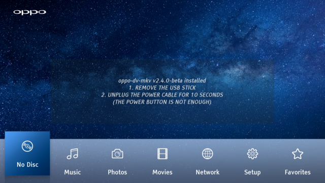](./images/install-en.png) | [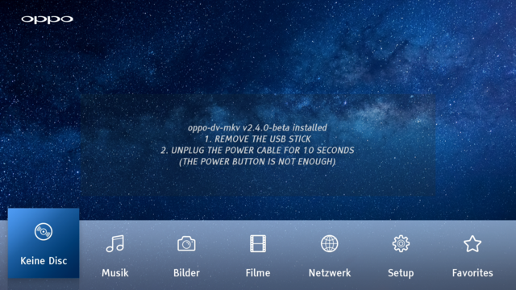](./images/install-de.png) | [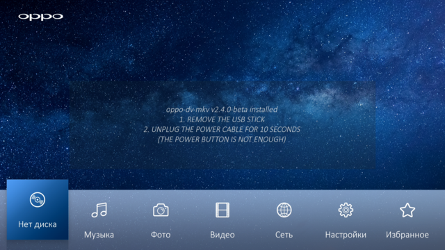](./images/install-ru.png)

## Boot screen

|   English   | Deutch |  Russian |
| :----------:   | :------: | :---------:  |
|  | [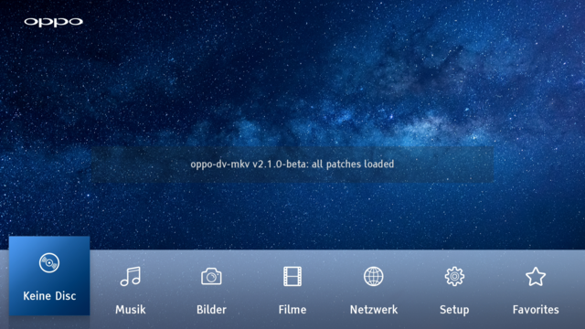](./images/boot-de.png) | [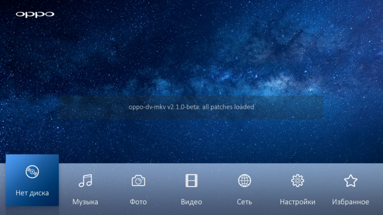](./images/boot-ru.png)

## Boot screen 2.4+

|   English   | Deutch |  Russian |
| :----------:   | :------: | :---------:  |
|  | [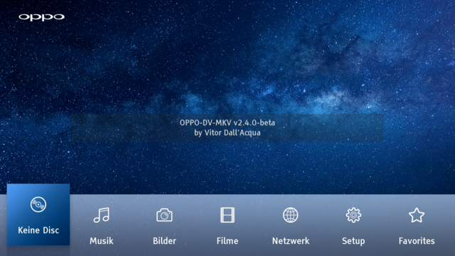](./images/boot1-de.png) | [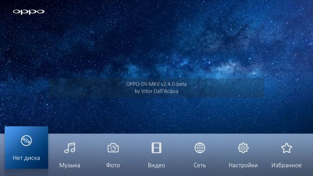](./images/boot1-ru.png)

## Extra settings

|   English   | Deutch |  Russian |
| :----------:   | :------: | :---------:  |
|  | [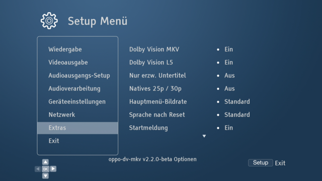](./images/extra-de.png) | [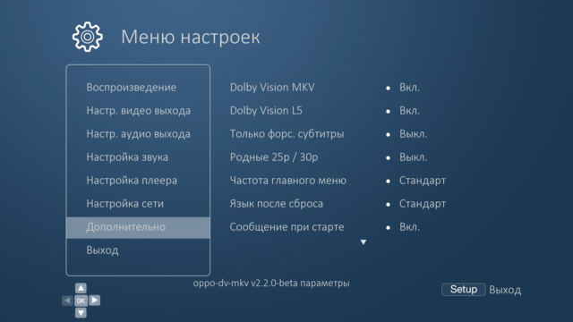](./images/extra-ru.png)

## Extra settings 2.4+

|   English   | Deutch |  Russian |
| :----------:   | :------: | :---------:  |
| [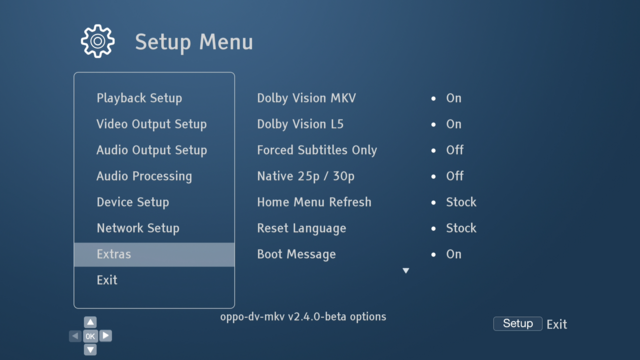](./images/extrav-en.png) |  | 
| [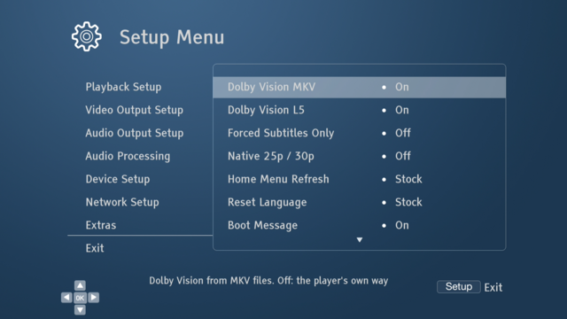](./images/extra-menu-en.png) | [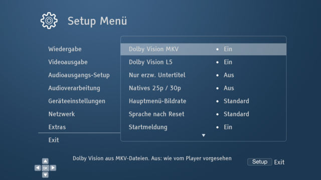](./images/extra-menu-de.png) | [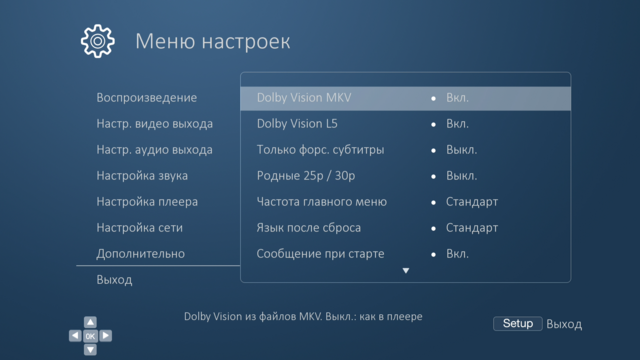](./images/extra-menu-ru.png)
