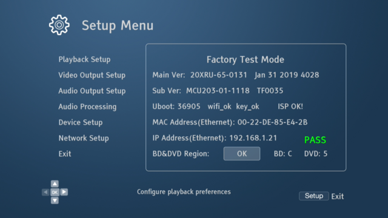
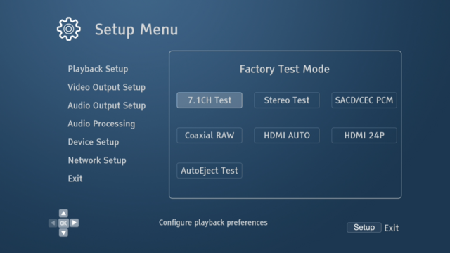
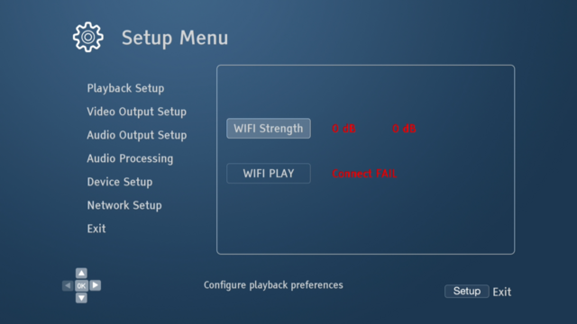
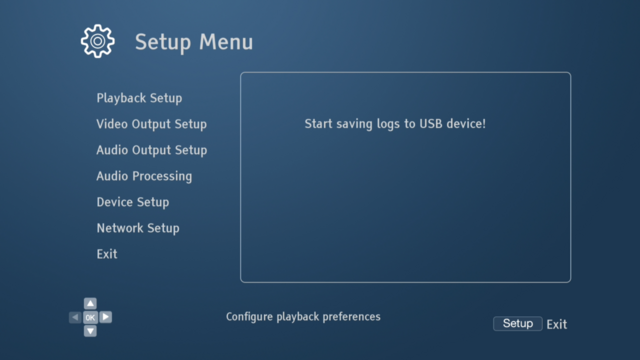
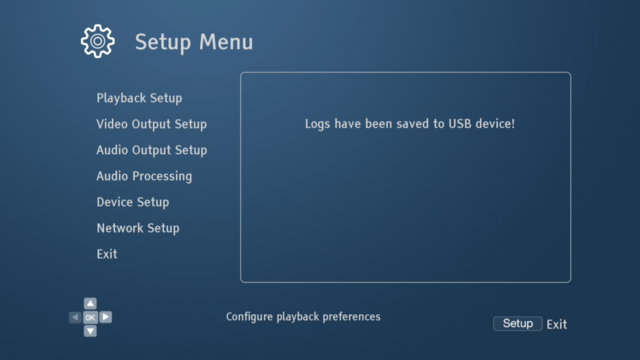
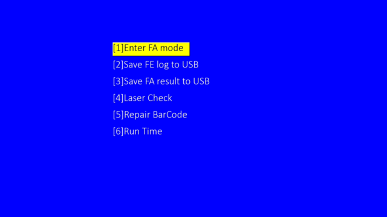

# OPPO Hidden codes in Setup menu

## 0770 -> Factory reset mode (may reset player settings on exit)

| | 
|:----------:|
| 

## 0880 -> Audio test mode ( may reset player settings on exit)

| | 
|:----------:|
| 

## 0660 -> Wifi test mode ( may reset player on exit)

| | 
|:----------:|
| 

## 7896 -> dump some logs in /mnt/sda1/UDP20x_log.txt

| | |
|:----------:|:----------:|
|  |  |

## 5177 -> Open Blu-ray firmware menu [6] which can show System Runtime for CD/DVD/BD.

|  | 
|:----------:|
| 
| 

